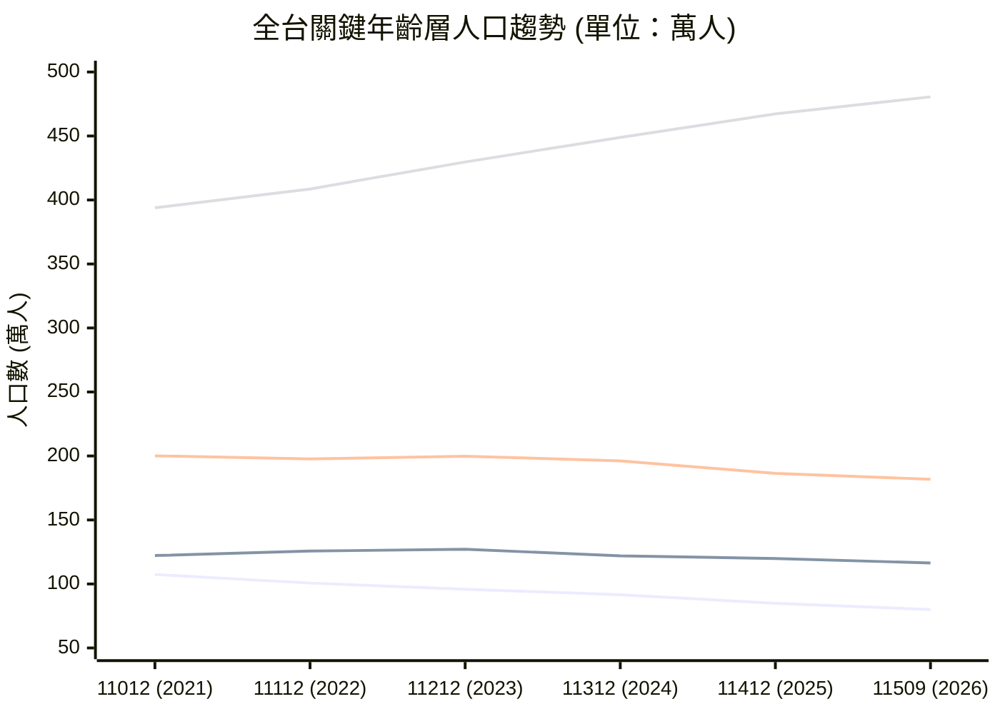
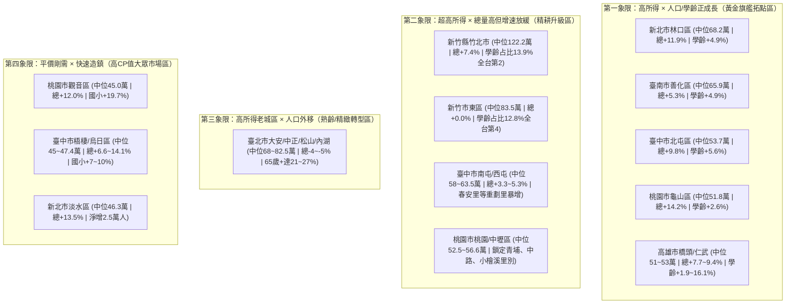

# 全台 368 鄉鎮市區近五年人口結構與消長趨勢分析簡報 (11012–11509)

> [!TIP]
> **互動式投影片體驗版**：您可直接以瀏覽器開啟 [taiwan_5yr_pop_analysis_presentation.html](file:///C:/Users/steven.chen/Desktop/Claude%20Project/side%20project/fable5/taiwan-pop-map/Report/taiwan_5yr_pop_analysis_presentation.html) 進行全螢幕投影片切換（支援鍵盤 `←` `→` 與空白鍵翻頁、互動圖表與全台 368 鄉鎮市區即時搜尋篩選器）。

---

## Slide 1: 簡報封面與研究範疇
* **簡報主題**：全台 368 鄉鎮市區近五年人口結構與消長趨勢深度分析（110年12月–115年9月）
* **資料來源**：
  - 內政部戶政司開放資料 `ODRP014`（村里戶數、0–100+ 歲單一年齡人口）
  - 財政部財政資訊中心綜稅所得統計（111 年度村里與鄉鎮市區中位數／平均數）
  - 涵蓋時間序列：`11012`（2021年底）、`11112`（2022年底）、`11212`（2023年底）、`11312`（2024年底）、`11412`（2025年底）共 5 個完整年度封存，以及最新一期 `11509`（2026年9月，總跨距 4.75 年）。
* **涵蓋規模**：全國 **22 個縣市**、**368 個鄉鎮市區**、**7,752 個村里**。

---

## Slide 2: 執行摘要 — 近五年台灣人口四大核心洞察 (Executive Summary)

1. **總人口微幅收縮，區域呈現「七成八衰退、二成二集中成長」的極端分化**
   - 全台總人口由 110 年底 **23,375,314 人** 降至 115 年 9 月 **23,213,251 人**（累計減少 **162,063 人**，**-0.69%**；若計至 114 年底則為 -0.33%）。
   - 全台 368 個鄉鎮市區中，僅 **86 區（23.4%）** 總人口正成長，高達 **282 區（76.6%）** 陷入人口淨流失。
2. **少子化海嘯衝擊學齡前（0–5歲），國小學齡（6–11歲）進入陡降拐點**
   - **0–5 歲幼兒人口**近五年由 **107.4 萬人** 暴跌至 **80.0 萬人**，重挫 **-25.53%（淨減 27.4 萬人）**。
   - **6–11 歲國小學齡人口**因虎年與龍年效應於 112 年底達峰值（127.1 萬人）後開始反轉，至 115 年 9 月降至 **116.4 萬人**（較 110 年底 **-4.75%**）。
   - **3–12 歲核心教育客群**由 **200.1 萬人** 降至 **181.8 萬人**（**-9.12%**，流失 18.25 萬人），全台僅 **29 個鄉鎮市區（7.9%）** 維持正成長。
3. **2025–2026 正式邁入「超高齡社會」，老化指數飆破 184**
   - **65 歲以上高齡人口**由 110 年底 **393.9 萬人（16.85%）** 激增至 115 年 9 月 **480.6 萬人（20.70%）**，大增 **86.7 萬人（+22.01%）**。
   - 全台已有 **260 個鄉鎮市區（70.7%）** 65 歲以上占比突破 20%（110 年底僅 138 區），更有 **23 個鄉鎮** 高齡占比突破 30%。
4. **「脫北潮」與「科技走廊／重劃區磁吸效應」重塑台灣人口版圖**
   - **臺北市**近五年淨流失 **10.55 萬人（-4.18%）**，大安、士林、內湖、北投單區皆流失逾萬人；反觀**桃園市（+8.62 萬，+3.79%）**、**臺中市（+5.29 萬，+1.88%）**、**新北市（+2.65 萬，+0.66%）**、**新竹縣（+2.26 萬，+3.93%）** 成為四大人口吸納引擎。

---

## Slide 3: 全台近五年人口總量與年齡結構演變 (11012–11509)

*(註：四條曲線由下至上依序為：0–5歲幼兒、6–11歲國小、3–12歲學齡、65歲以上高齡人口)*

| 統計期別 | 全台總人口 | 0–5歲 (學齡前) | 6–11歲 (國小) | 3–12歲 (核心學齡) | 12–17歲 (國高中) | 18–64歲 (青壯年) | 65歲+ (高齡人口) | 65歲+ 占比 | 老化指數 |
| :-: | --: | --: | --: | --: | --: | --: | --: | --: | --: |
| **11012** | 23,375,314 | 1,073,976 | 1,221,953 | 2,000,589 | 1,221,771 | 15,918,581 | 3,939,033 | 16.85% | 136.3 |
| **11112** | 23,264,640 | 1,006,790 | 1,257,417 | 1,976,755 | 1,167,966 | 15,746,674 | 4,085,793 | 17.56% | 144.9 |
| **11212** | 23,420,442 | 958,734 | 1,270,945 | 1,998,415 | 1,174,518 | 15,719,260 | 4,296,985 | 18.35% | 153.8 |
| **11312** | 23,400,220 | 915,634 | 1,220,066 | 1,962,346 | 1,206,685 | 15,569,128 | 4,488,707 | 19.18% | 163.7 |
| **11412** | 23,299,132 | 849,120 | 1,199,046 | 1,863,631 | 1,195,298 | 15,382,513 | 4,673,155 | 20.06% | 174.2 |
| **11509** | **23,213,251** | **799,761** | **1,163,946** | **1,818,052** | **1,204,349** | **15,239,142** | **4,806,053** | **20.70%** | **184.4** |
| **五年變化** | **-162,063 (-0.69%)** | **-274,215 (-25.53%)** | **-58,007 (-4.75%)** | **-182,537 (-9.12%)** | **-17,422 (-1.43%)** | **-679,439 (-4.27%)** | **+867,020 (+22.01%)** | **+3.85 pt** | **+48.1** |

---

## Slide 4: 22 縣市人口消長全覽 — 桃竹中領漲，北高彰嘉流失最劇

* **正成長縣市僅 7 個**：新竹縣 (+3.93%)、桃園市 (+3.79%)、臺中市 (+1.88%)、新竹市 (+0.68%)、新北市 (+0.66%)、澎湖縣 (+0.36%)、連江縣 (+0.11%)。
* **六都表現兩極化**：
  - **成長組**：桃園市 (+86,220 人)、臺中市 (+52,877 人)、新北市 (+26,459 人)。
  - **衰退組**：臺北市 (-105,521 人，-4.18%)、高雄市 (-39,451 人，-1.44%)、臺南市 (-16,746 人，-0.90%)。

| 排名 | 縣市別 | 11012 總人口 | 11412 總人口 | 11509 總人口 | 近五年淨增減 | 總人口成長率 | 3–12歲變化率 | 0–5歲變化率 | 6–11歲變化率 | 11509 高齡占比 |
| :-: | :--- | --: | --: | --: | --: | --: | --: | --: | --: | --: |
| 1 | **新竹縣** | 575,580 | 597,235 | 598,229 | **+22,649** | **+3.93%** | -5.31% | -19.98% | -2.81% | **15.5%** (最年輕) |
| 2 | **桃園市** | 2,272,391 | 2,355,106 | 2,358,611 | **+86,220** | **+3.79%** | -5.34% | -24.82% | -0.64% | 17.3% |
| 3 | **臺中市** | 2,813,490 | 2,868,465 | 2,866,367 | **+52,877** | **+1.88%** | -7.30% | -24.79% | -2.14% | 18.0% |
| 4 | **新竹市** | 452,640 | 455,740 | 455,731 | **+3,091** | **+0.68%** | -12.10% | -25.84% | -9.36% | 16.7% |
| 5 | **新北市** | 4,008,113 | 4,044,831 | 4,034,572 | **+26,459** | **+0.66%** | -10.52% | -27.62% | -6.64% | 20.7% |
| 6 | **澎湖縣** | 106,340 | 106,716 | 106,725 | +385 | +0.36% | -2.82% | -22.50% | +1.07% | 21.8% |
| 7 | **連江縣** | 13,645 | 13,621 | 13,660 | +15 | +0.11% | -11.25% | -34.20% | -4.19% | 17.8% |
| 8 | **宜蘭縣** | 450,692 | 449,336 | 447,883 | -2,809 | -0.62% | -6.91% | -21.66% | -2.28% | 21.4% |
| 9 | **臺南市** | 1,862,059 | 1,852,477 | 1845,313 | -16,746 | -0.90% | -8.43% | -24.57% | -3.75% | 21.2% |
| 10 | **嘉義市** | 264,727 | 261,592 | 261,429 | -3,298 | -1.25% | -10.85% | -21.97% | -6.87% | 20.5% |
| 11 | **高雄市** | 2,744,691 | 2,718,545 | 2,705,240 | -39,451 | -1.44% | -8.42% | -24.65% | -4.16% | 21.4% |
| 12 | **苗栗縣** | 538,178 | 531,172 | 529,012 | -9,166 | -1.70% | -9.91% | -21.82% | -5.87% | 20.8% |
| 13 | **基隆市** | 363,977 | 359,836 | 357,575 | -6,402 | -1.76% | -9.36% | -29.73% | -3.55% | 23.1% |
| 14 | **臺東縣** | 213,386 | 208,320 | 207,454 | -5,932 | -2.78% | -8.18% | -15.28% | -5.85% | 21.5% |
| 15 | **金門縣** | 141,539 | 139,313 | 137,490 | -4,049 | -2.86% | -11.67% | -37.27% | -4.13% | 20.4% |
| 16 | **花蓮縣** | 321,358 | 312,807 | 310,550 | -10,808 | -3.36% | -11.01% | -25.71% | -6.78% | 22.2% |
| 17 | **屏東縣** | 804,440 | 782,256 | 777,252 | -27,188 | -3.38% | -6.07% | -16.48% | -2.30% | 22.5% |
| 18 | **雲林縣** | 670,132 | 650,989 | 645,881 | -24,251 | -3.62% | -9.48% | -12.86% | -6.85% | 22.3% |
| 19 | **南投縣** | 484,897 | 467,881 | 465,984 | -18,913 | -3.90% | -7.68% | -19.34% | -4.91% | 23.5% |
| 20 | **臺北市** | 2,524,393 | 2,439,507 | 2,418,872 | **-105,521** | **-4.18%** | -14.31% | -32.87% | -8.52% | **24.9%** (最高齡) |
| 21 | **彰化縣** | 1,255,330 | 1,210,206 | 1,200,447 | **-54,883** | **-4.37%** | -11.11% | -29.08% | -7.06% | 21.0% |
| 22 | **嘉義縣** | 493,316 | 473,181 | 468,974 | **-24,342** | **-4.93%** | -9.54% | -22.38% | -6.53% | **24.8%** |

---

## Slide 5: 鄉鎮市區總人口成長 TOP 15 — 重劃區與科技走廊強勢崛起

> [!IMPORTANT]
> **成長動能解析**：總人口成長率前 15 強（基期 ≥ 5,000 人）全數由**大型新市鎮／重劃區**與**科學園區外溢帶**包辦。其中**桃園龜山（A7重劃區）**、**臺中梧棲（台中港新市鎮）**、**新北淡水（淡海新市鎮）**、**桃園觀音（草漯重劃區）**、**新北林口**五年成長率皆突破 **+11%**。

### A. 總人口「成長率」TOP 15（基期人口 ≥ 5,000 人）
| 排名 | 鄉鎮市區 | 11012 人口 | 11412 人口 | 11509 人口 | 五年淨增加 | 五年成長率 | 年化成長率 (CAGR) | 綜稅所得中位數 | 核心帶動因素 |
| :-: | :--- | --: | --: | --: | --: | --: | --: | --: | :--- |
| **1** | **桃園市龜山區** | 166,767 | 188,328 | 190,506 | +23,739 | **+14.23%** | +2.84% | 518 千元 | A7 機捷重劃區交屋潮、長庚生活圈 |
| **2** | **臺中市梧棲區** | 59,517 | 65,685 | 67,903 | +8,386 | **+14.09%** | +2.81% | 474 千元 | 台中港特定區大型造鎮推案 |
| **3** | **新北市淡水區** | 185,197 | 208,004 | 210,196 | +24,999 | **+13.50%** | +2.70% | 463 千元 | 淡海新市鎮、輕軌與淡江大橋預期 |
| **4** | **桃園市觀音區** | 69,995 | 77,526 | 78,376 | +8,381 | **+11.97%** | +2.41% | 450 千元 | 草漯重劃區低總價透天/大樓吸納就業人口 |
| **5** | **新北市林口區** | 124,628 | 138,461 | 139,499 | +14,871 | **+11.93%** | +2.40% | **682 千元** | 林口新市鎮、機捷 A9、媒體園區高所得移入 |
| **6** | **臺中市北屯區** | 290,653 | 317,182 | 319,081 | **+28,428** | **+9.78%** | +1.98% | 537 千元 | 機捷特區、14期、廍子重劃區（全台淨增王） |
| **7** | **高雄市橋頭區** | 40,094 | 43,341 | 43,849 | +3,755 | **+9.37%** | +1.90% | 508 千元 | 高雄新市鎮、橋頭科學園區與台積電外溢 |
| **8** | **新北市八里區** | 40,178 | 43,495 | 43,489 | +3,311 | **+8.24%** | +1.68% | 435 千元 | 台北港特定區、64快速道路房價外溢 |
| **9** | **高雄市仁武區** | 93,581 | 100,311 | 100,748 | +7,167 | **+7.66%** | +1.57% | 528 千元 | 仁武產業園區、鄰左營高鐵生活圈外溢 |
| **10** | **新竹縣竹北市** | 206,189 | 220,973 | 221,344 | +15,155 | **+7.35%** | +1.51% | **1,222 千元** | 竹科核心高所得聚落、高鐵特區（全台最富） |
| **11** | **新竹縣湖口鄉** | 79,602 | 84,963 | 85,133 | +5,531 | **+6.95%** | +1.43% | 499 千元 | 王爺壟重劃區、新竹工業區就業人口移入 |
| **12** | **臺南市安平區** | 67,446 | 71,256 | 71,958 | +4,512 | **+6.69%** | +1.37% | 538 千元 | 五期市政特區、國平重劃區大樓交屋 |
| **13** | **臺中市烏日區** | 77,245 | 82,248 | 82,368 | +5,123 | **+6.63%** | +1.36% | 452 千元 | 台中高鐵特區三鐵共構大型推案 |
| **14** | **臺中市沙鹿區** | 96,039 | 101,419 | 101,911 | +5,872 | **+6.11%** | +1.26% | 465 千元 | 中科西屯外溢、沙鹿火車站西側重劃 |
| **15** | **臺南市善化區** | 51,265 | 53,888 | 53,985 | +2,720 | **+5.31%** | +1.10% | **659 千元** | 南科核心生活圈（LM特區），高所得年輕家庭 |

*(註：澎湖縣湖西鄉成長率 +5.33% 位居第15，上表併列本島具代表性之南科核心善化區 +5.31%)*

### B. 總人口「絕對淨增加數」TOP 10
1. **臺中市北屯區**：**+28,428 人**（290,653 → 319,081，+9.78%）
2. **新北市淡水區**：**+24,999 人**（185,197 → 210,196，+13.50%）
3. **桃園市龜山區**：**+23,739 人**（166,767 → 190,506，+14.23%）
4. **桃園市桃園區**：**+19,612 人**（458,847 → 478,459，+4.27%，中路/小檜溪重劃區）
5. **桃園市中壢區**：**+16,306 人**（422,529 → 438,835，+3.86%，青埔高鐵特區）
6. **新竹縣竹北市**：**+15,155 人**（206,189 → 221,344，+7.35%）
7. **新北市林口區**：**+14,871 人**（124,628 → 139,499，+11.93%）
8. **臺中市南屯區**：**+9,312 人**（176,782 → 186,094，+5.27%，單元二/三與嶺東建功）
9. **臺中市梧棲區**：**+8,386 人**（59,517 → 67,903，+14.09%）
10. **桃園市觀音區**：**+8,381 人**（69,995 → 78,376，+11.97%）

---

## Slide 6: 學齡兒童 (3–12歲 / 6–11歲) 逆勢成長熱區 — 教育與親子產業黃金藍海

> [!IMPORTANT]
> 在全台 3–12 歲兒童大減 18.25 萬人（-9.12%）的嚴峻環境下，全台僅 **29 個鄉鎮市區** 實現 3–12 歲正成長。其中 **「總人口與 3–12 歲學齡人口雙成長」且基期破萬人的行政區僅 20 區**，是全台灣少數具備長期教育需求擴張的黃金市場。

### 全台「總人口 × 3–12歲學齡人口」雙成長 TOP 15 標竿行政區
| 排名 | 鄉鎮市區 | 11012 學齡(3–12) | 11509 學齡(3–12) | 3–12歲淨增 | 3–12歲成長率 | 6–11歲(國小)成長率 | 0–5歲(幼兒)成長率 | 總人口成長率 | 所得中位數 | 戰略分級與客群定位 |
| :-: | :--- | --: | --: | --: | --: | --: | --: | --: | --: | :--- |
| **1** | **臺中市北屯區** | 29,449 | 31,091 | **+1,642** | **+5.58%** | +11.2% | -12.7% | +9.78% | 537 千元 | **旗艦量體王**：全台學齡淨增第一，舊社/廍子國小爆滿 |
| **2** | **新北市林口區** | 15,981 | 16,769 | **+788** | **+4.93%** | +9.1% | -15.7% | +11.93% | **682 千元** | **高所得雙語熱區**：學齡占比達 12.0%，消費力極強 |
| **3** | **桃園市觀音區** | 6,029 | 6,616 | **+587** | **+9.74%** | **+19.7%** | -10.0% | +11.97% | 450 千元 | **年輕剛需型**：草漯重劃區國小學童激增近兩成 |
| **4** | **高雄市橋頭區** | 2,712 | 3,148 | **+436** | **+16.08%** | **+18.0%** | **+0.2%** | +9.37% | 508 千元 | **南台灣成長冠**：新莊里/甲北里科技新貴家庭湧入 |
| **5** | **桃園市龜山區** | 14,951 | 15,346 | **+395** | **+2.64%** | +6.4% | -13.4% | +14.23% | 518 千元 | **A7 新興家庭池**：樂善/文青國小周邊學童密集 |
| **6** | **新竹縣湖口鄉** | 7,669 | 8,041 | **+372** | **+4.85%** | +3.5% | -1.8% | +6.95% | 499 千元 | **竹科外溢剛需**：0–5歲幾乎不減(-1.8%)，生育力強 |
| **7** | **南投縣草屯鎮** | 7,288 | 7,625 | **+337** | **+4.62%** | +0.9% | **+9.6%** | +1.37% | 452 千元 | **彰投唯一亮點**：0–5歲逆勢正成長 +9.6% |
| **8** | **臺南市善化區** | 5,724 | 6,003 | **+279** | **+4.87%** | +11.1% | -15.8% | +5.31% | **659 千元** | **南科高所得核心**：所得中位數全台南最高，國小+11% |
| **9** | **臺中市中區** | 2,297 | 2,508 | **+211** | **+9.19%** | **+22.5%** | -36.4% | +1.82% | 452 千元 | **學區設籍效應**：3–12歲占比 13.92% 全台最高 |
| **10** | **臺中市梧棲區** | 6,157 | 6,356 | **+199** | **+3.23%** | +10.3% | -12.4% | +14.09% | 474 千元 | **海線造鎮熱區**：頂寮里學童倍增，國小生+10.3% |
| **11** | **臺中市烏日區** | 7,386 | 7,553 | **+167** | **+2.26%** | +7.4% | -14.0% | +6.63% | 452 千元 | **高鐵門戶社區**：國小生穩定成長 +7.4% |
| **12** | **高雄市仁武區** | 7,150 | 7,286 | **+136** | **+1.90%** | +4.4% | -11.8% | +7.66% | 528 千元 | **北高雄擴張帶**：人口突破十萬大關，國小生+4.4% |
| **13** | **臺南市歸仁區** | 5,948 | 6,051 | **+103** | **+1.73%** | +6.1% | -19.0% | +4.68% | 472 千元 | **台南高鐵沙崙特區**：三井Outlet與成大沙崙帶動 |
| **14** | **花蓮縣秀林鄉** | 1,701 | 1,801 | **+100** | **+5.88%** | +12.8% | -13.8% | +4.49% | 405 千元 | **東台灣唯一雙成長**：年輕人口結構穩定 |
| **15** | **嘉義縣太保市** | 3,213 | 3,273 | **+60** | **+1.87%** | +7.0% | -22.2% | +2.78% | 529 千元 | **嘉義高鐵＋科學園區**：縣治特區與台積電封測廠題材 |

> [!NOTE]
> **特殊政策異常值提醒**：彰化縣竹塘鄉（3–12歲 +33.2%，6–11歲 +57.2%）與屏東縣內埔鄉（0–5歲 +20.3%）雖總人口停滯或微減，但因高額生育津貼或學區福利政策引發**戶籍遷入效應**，分析實體商圈需求時應留意「設籍不住籍」現象。

---

## Slide 7: 鄉鎮市區人口流失與超高齡化預警 (Declining & Super-Aged Hotspots)

### A. 都會核心「脫北與空洞化」— 總人口淨流失最多 TOP 10 行政區
高房價與老舊住宅推升年輕家庭外移，**臺北市包辦全國人口淨減少前 10 名中的 8 席**：
1. **臺北市士林區**：**-14,102 人**（269,682 → 255,580，-5.23%｜3–12歲 -14.3%｜65歲+ 26.1%）
2. **臺北市大安區**：**-11,793 人**（291,410 → 279,617，-4.05%｜3–12歲 -10.8%｜65歲+ 26.6%）
3. **臺北市內湖區**：**-11,270 人**（276,707 → 265,437，-4.07%｜3–12歲 -11.0%｜65歲+ 21.3%）
4. **臺北市北投區**：**-10,777 人**（244,750 → 233,973，-4.40%｜3–12歲 -15.6%｜65歲+ 24.1%）
5. **彰化縣彰化市**：**-10,033 人**（228,470 → 218,437，-4.39%｜3–12歲 -11.7%｜65歲+ 21.3%）
6. **臺北市文山區**：**-9,474 人**（261,576 → 252,102，-3.62%｜3–12歲 -16.6%｜65歲+ 22.9%）
7. **臺北市萬華區**：**-9,442 人**（176,617 → 167,175，-5.35%｜3–12歲 -23.4%｜65歲+ 27.1%）
8. **臺北市信義區**：**-8,302 人**（207,500 → 199,198，-4.00%｜3–12歲 -15.5%｜65歲+ 26.8%）
9. **臺北市中正區**：**-7,971 人**（150,644 → 142,673，-5.29%｜3–12歲 -12.6%｜65歲+ 24.3%）
10. **臺北市松山區**：**-7,688 人**（193,388 → 185,700，-3.98%｜3–12歲 -12.7%｜65歲+ 25.6%）

### B. 偏鄉「極限村落化」— 衰退率最高 & 高齡占比最高鄉鎮
* **五年人口跌幅最深（基期 ≥ 5,000 人）**：
  1. 新北市石門區 (**-12.04%**, 3–12歲 -31.3%)
  2. 高雄市田寮區 (**-11.71%**, 0–5歲 -51.4%)
  3. 苗栗縣西湖鄉 (**-11.22%**, 3–12歲 -33.3%)
  4. 新北市貢寮區 (**-11.22%**, 65歲+ 28.4%)
  5. 彰化縣大城鄉 (**-11.02%**, 65歲+ 28.4%)
  6. 新北市雙溪區 (**-10.98%**, 65歲+ 34.3%)
  7. 苗栗縣大湖鄉 (**-10.61%**, 0–5歲 -38.7%)
  8. 臺南市北門區 (**-10.54%**, 0–5歲 -53.2%)
* **全台最老鄉鎮 TOP 5（11509 高齡 65+ 占比）**：
  1. **臺南市龍崎區**：**37.7%**（五年總人口 -13.85%，全區 3–12 歲僅剩 64 人）
  2. **新北市平溪區**：**37.4%**（五年總人口 -10.89%，全區 3–12 歲僅剩 69 人）
  3. **臺南市左鎮區**：**35.1%**（五年總人口 -8.83%，全區 3–12 歲僅剩 121 人）
  4. **高雄市田寮區**：**34.7%**（五年總人口 -11.71%，全區 3–12 歲僅剩 160 人）
  5. **新北市雙溪區**：**34.3%**（五年總人口 -10.98%，全區 3–12 歲僅剩 230 人）

---

## Slide 8: 村里級微觀下鑽 — 全台成長最猛烈的「造鎮級超級村里」TOP 10

透過村里層級（7,752 村里）下鑽分析，即使在總人口微減的縣市（如臺南、高雄、臺北），重劃區與社宅交屋所在的單一村里仍出現 **+100% 至 +286%** 的爆發式增長：

| 排名 | 村里名稱 (所屬鄉鎮) | 11012 總人口 | 11509 總人口 | 總人口成長率 | 11012 學齡(3–12) | 11509 學齡(3–12) | 3–12歲成長率 | 微觀成長動能解析 |
| :-: | :--- | --: | --: | --: | --: | --: | --: | :--- |
| **1** | **臺中市南屯區春安里** | 1,753 | 5,728 | **+226.8%** | 160 | 619 | **+286.9%** | 嶺東建功重劃區大型造鎮交屋，學童翻近 4 倍 |
| **2** | **臺中市北屯區舊社里** | 9,245 | 23,144 | **+150.3%** | 822 | 2,732 | **+232.4%** | 機捷特區＋14期核心，單里暴增 1.39 萬人、近2千學童 |
| **3** | **桃園市蘆竹區山鼻里** | 2,047 | 5,604 | **+173.8%** | 130 | 306 | **+135.4%** | 機捷 A10 山鼻站重劃區新大樓密集落成 |
| **4** | **臺中市梧棲區頂寮里** | 4,339 | 10,867 | **+150.4%** | 392 | 898 | **+129.1%** | 台中港市鎮中心遠雄等大型造鎮社區交屋 |
| **5** | **新北市新店區中山里** | 4,920 | 12,188 | **+147.7%** | 284 | 629 | **+121.5%** | 央北重劃區＋十四張站大型住宅社區入厝 |
| **6** | **桃園市桃園區青溪里** | 5,253 | 12,481 | **+137.6%** | 669 | 1,559 | **+133.0%** | 小檜溪重劃區核心，年輕雙薪家庭大量移入 |
| **7** | **桃園市桃園區文中里** | 5,377 | 9,189 | **+70.9%** | 543 | 1,263 | **+132.6%** | 中路重劃區（文山國小學區），學童淨增逾 700 人 |
| **8** | **高雄市橋頭區新莊里** | 5,559 | 9,012 | **+62.1%** | 387 | 929 | **+140.1%** | 高雄新市鎮一期，受惠台積電楠梓/橋科題材 |
| **9** | **臺北市信義區大仁里** | 3,818 | 7,988 | **+109.2%** | 208 | 511 | **+145.7%** | 廣慈博愛園區社會住宅與都更案大量入住 |
| **10** | **臺南市東區東智里** | 3,219 | 5,333 | **+65.7%** | 253 | 598 | **+136.4%** | 平實營區與南台南副都心周邊新大樓入駐 |

---

## Slide 9: 人口 × 所得交叉矩陣 — 商業展店與資源配置策略建議

結合 **近五年人口／學齡成長率** 與 **財政部綜稅所得中位數**，可將全台 368 鄉鎮市區劃分為四大戰略象限：

### 具體行動建議 (Actionable Insights)
1. **教育／才藝／親子零售展店策略**：
   - **首選「雙成長重劃區」**：優先鎖定 **臺中北屯（舊社/廍子）、新北林口、桃園龜山（A7樂善/文青）、桃園中壢（青埔）、桃園區（中路/小檜溪）、臺南善化、高雄橋頭**。這些區域 6–11 歲國小生逆勢成長 +6%～+19%，且家庭所得中位數高於全國均值。
   - **大行政區必須「以里選點」**：如桃園區、中壢區、南屯區整體 3–12 歲雖微減 -3%～-5%，但內部的**青溪里、文中里、春安里**學童卻暴增 +130%～+286%，選址必須下鑽至村里與國小 500m 生活圈。
2. **醫療照護／銀髮樂齡產業佈局**：
   - **鎖定都會高所得高齡區**：**臺北市大安、信義、士林、松山、萬華** 65 歲以上人口占比已達 **25%–27%**，且所得中位數高達 60–82 萬，具備極高自費醫療、日間照護與銀髮財富管理需求。
3. **未來三年預警（2026–2029）**：
   - 全台 0–5 歲幼兒五年已減少 **25.5%**，這批幼童將於未來 1–5 年陸續進入國小（6–11歲）。除上述 Top 20 雙成長重劃區外，多數傳統鄉鎮的國小入學人數將在未來三年面臨 **-15% 至 -25%** 的結構性縮減，資源配置宜提前向核心成長極集中。
